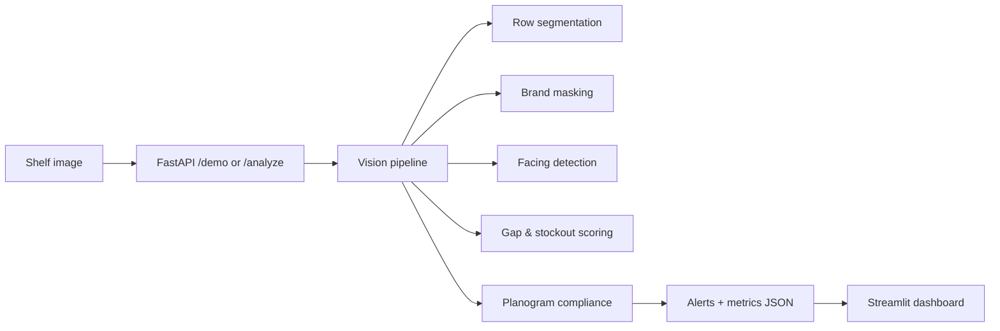

<div align="center">


</div>

# GapX

**GapX is an AI-powered retail shelf intelligence system** that detects empty shelf spaces, flags likely stockouts, monitors product placement, and generates restocking alerts from shelf imagery.

It is designed to help merchandising, operations, and field audit teams answer one practical question quickly:

> *Is this shelf stocked, compliant, and ready for shoppers right now?*

---

## Problem statement

Retail shelves change constantly. Products move, facings disappear, labels shift, and stockouts can go unnoticed until they affect sales. Manual shelf checks are slow and inconsistent, while generic object detection tools often lack the shelf-specific logic needed for:

- empty-shelf gap detection
- planogram compliance checks
- stockout identification
- restocking prioritization
- clear visual audit trails

GapX uses computer vision heuristics to turn a shelf photo into actionable shelf-health signals.

---

## Key features

- **Shelf-gap detection** — identifies unoccupied shelf spans that likely indicate missing inventory.
- **Stockout alerts** — highlights rows with gaps or reduced facing counts that need attention.
- **Planogram compliance** — compares detected brand order against the expected shelf layout.
- **Product placement monitoring** — tracks facing order and brand distribution across rows.
- **Real-time-style alerting** — surfaces shelf issues immediately in the API response and dashboard.
- **FastAPI backend** — clean JSON responses for integrations and automation.
- **Streamlit dashboard** — a polished UI for demos, operations, and review.
- **Synthetic demo mode** — renders reproducible shelf scenes for offline testing and hackathons.

---

## Architecture



### Pipeline overview

1. **Row segmentation** isolates shelf bands from the image using saturation projection.
2. **Brand masking** separates products by configurable hue ranges.
3. **Facing detection** extracts bounding boxes for visible facings.
4. **Gap detection** counts empty spans within each shelf row.
5. **Planogram scoring** compares detected order against the expected layout.
6. **Alert generation** converts the analysis into restock and compliance messages.

---

## Technology stack

- **Python 3.12**
- **OpenCV** for image processing
- **NumPy** and **Pandas** for data handling
- **FastAPI** for the API layer
- **Uvicorn** for the ASGI server
- **Streamlit** for the dashboard
- **Plotly** for visual reporting
- **Pydantic Settings** for configuration
- **python-multipart** for image upload handling
- **Pytest** for automated tests
- **uv** for reproducible dependency management

---

## Repository layout

```text
src/shelfsight/     Core application package
configs/            Shelf, brand, and planogram configuration
docs/brand/         Logo and banner assets
tests/              Unit tests for the analysis and streaming layers
Dockerfile          API container image
Dockerfile.ui       Streamlit container image
Makefile            Common commands
tasks.ps1           Windows PowerShell task runner
```

---

## Installation

### Prerequisites

- Python 3.12
- `uv` package manager
- Windows, macOS, or Linux

### Recommended setup with `uv`

```bash
uv sync --group dev
```

This creates the project virtual environment and installs the locked dependencies.

### Windows CMD setup

```cmd
cd /d K:\GapX
py -3.12 -m venv .venv
call .venv\Scripts\activate.bat
python -m pip install --upgrade pip
pip install uv
uv sync --group dev
copy .env.example .env
```

---

## Configuration

Copy `.env.example` to `.env` and adjust values as needed.

```env
MLFLOW_TRACKING_URI=sqlite:///mlflow.db
GAPX_API_URL=http://localhost:8210
```

The application also accepts the legacy `SHELFSIGHT_API_URL` variable for compatibility, but `GAPX_API_URL` is preferred.

Shelf and brand settings live in [configs/config.yaml](./configs/config.yaml).

---

## Running the project

### API

```cmd
call .venv\Scripts\activate.bat
uv run uvicorn shelfsight.api.main:app --reload --port 8210
```

### Dashboard

```cmd
call .venv\Scripts\activate.bat
set GAPX_API_URL=http://localhost:8210
uv run streamlit run src\shelfsight\ui\app.py --server.port 8711
```

### Run both with the helper scripts

```cmd
make api
make ui
```

or on Windows PowerShell:

```powershell
.\tasks.ps1 api
.\tasks.ps1 ui
```

### Docker

```cmd
docker compose up --build
```

Then open:

- API: http://localhost:8210
- UI: http://localhost:8711

---

## Usage examples

### Health check

```cmd
curl http://localhost:8210/health
```

### Analyze an uploaded shelf image

```cmd
curl -X POST "http://localhost:8210/analyze" ^
  -F "file=@shelf.jpg"
```

### Analyze a synthetic demo shelf

```cmd
curl "http://localhost:8210/demo"
curl "http://localhost:8210/demo?swap=true"
curl "http://localhost:8210/demo?gaps=true"
```

The `/demo` endpoint is especially useful for hackathons because it produces reproducible shelf scenes with optional swaps and gaps.

---

## API response highlights

GapX returns:

- `boxes` — detected facings with coordinates and brand labels
- `share_of_shelf` — facing distribution by brand
- `facings_per_row` — per-row brand order and gap count
- `planogram` — compliance score and per-row comparison
- `alerts` — human-readable restocking and stockout messages

Example excerpt:

```json
{
  "total_facings": 12,
  "share_of_shelf": {
    "bluebrand": 0.25,
    "greenfoods": 0.25,
    "orangeline": 0.25,
    "redco": 0.25
  },
  "alerts": [
    {
      "severity": "high",
      "type": "restock-gap",
      "row": 1,
      "message": "Row 2 has 1 empty shelf gap(s) that need restocking."
    }
  ]
}
```

---

## Screenshots

Add product screenshots here when you capture them from the dashboard:

| Asset | Purpose |
|---|---|
| `docs/brand/banner.svg` | Branded hero banner for the README and demo materials |
| `docs/brand/logo.svg` | Compact GapX icon for UI and slides |
| Dashboard capture | Show detected facings, alerts, and planogram compliance |

Recommended screenshots to capture:

1. Clean shelf detection view.
2. Shelf with a planted gap and the resulting alert.
3. Shelf with planogram swap and reduced compliance score.

---

## Testing

```cmd
uv run pytest --cov
uv run ruff check .
uv run ruff format --check .
```

The test suite covers row detection, gap detection, planogram compliance, streaming handlers, and API endpoints.

---

## Limitations

- GapX currently uses classical computer vision heuristics rather than a trained detection model.
- Performance depends on shelf lighting, camera angle, and product packaging colors.
- The synthetic demo is deterministic enough for hackathons, but real shelves may require tuning in `configs/config.yaml`.
- Severe occlusion, reflective packaging, and very crowded shelves can reduce detection quality.

---

## Troubleshooting

- **`API not reachable` in the UI**  
  Start the API first and confirm it is listening on port `8210`.

- **`uv` command not found**  
  Install it with `python -m pip install uv`.

- **OpenCV import errors on Windows**  
  Recreate the virtual environment with Python 3.12 and rerun `uv sync --group dev`.

- **Blank dashboard or missing alerts**  
  Verify `GAPX_API_URL` is set correctly and that the API returns JSON from `/demo`.

---

## License

MIT License. See [LICENSE](./LICENSE).
