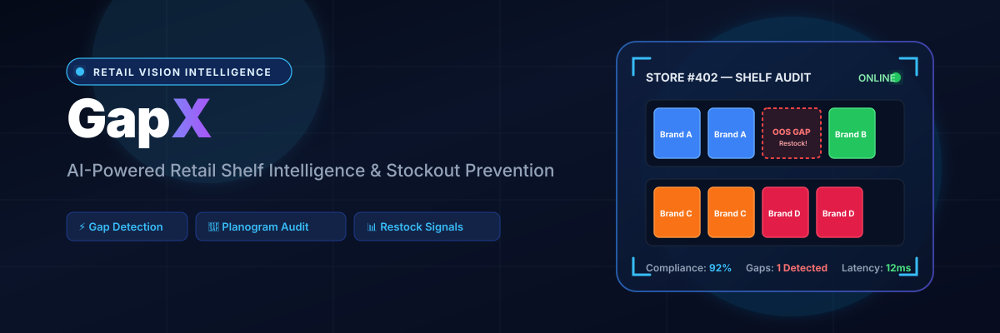
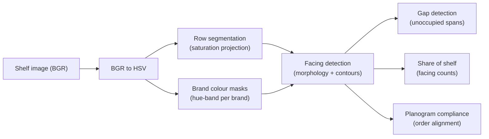

<div align="center">



</div>

# ShelfSight — Retail Shelf Vision & Planogram Compliance

**Audit a retail shelf from a single photo.** ShelfSight uses classical computer vision — no training, no GPU — to find product facings, measure each brand's share of shelf, spot out-of-stock gaps, and score how well the shelf matches its planogram (the intended left-to-right brand layout). Every stage returns an inspectable artifact, so a field auditor can see *why* the pipeline made each call.

<div align="center">

[](https://www.python.org/)
[](https://fastapi.tiangolo.com/)
[](https://opencv.org/)
[](https://opensource.org/licenses/MIT)

</div>

---

## The problem

Retail brands pay for shelf space and expect it to be honoured: the right products, in the right order, fully stocked. Verifying that today means a person walking the aisle with a clipboard. The visual question is deceptively hard:

- **Where are the shelf rows?** Metal rails and background blur into the products.
- **Which brand is each product?** Packaging colour is the fastest cue, but lighting and labels get in the way.
- **Is anything missing?** An empty slot is a lost sale — but so is a shadow that only *looks* empty.
- **Is the layout correct?** The planogram specifies an exact left-to-right order per row; a swapped facing is a compliance failure.

ShelfSight answers all four from one image and returns numbers a merchandiser can act on: facing counts, share of shelf per brand, gap counts, and a per-row compliance score.

## What it does

Given a shelf image, the pipeline produces:

- **Facings** — bounding boxes for each detected product, tagged by brand and row.
- **Share of shelf** — the fraction of facings belonging to each brand.
- **Gaps** — count of out-of-stock spans per row.
- **Planogram compliance** — how closely the detected brand order matches the expected order, per row and overall.

## How it works

The pipeline is pure OpenCV: colour-space conversion, saturation projection, hue-band masking, morphology, and contour extraction. There is no learned model and no labelled training data — the logic is fully explainable and every stage exposes its intermediate output.



The end-to-end procedural pipeline lives in `vision/analyze.py` and is what the API calls. The same stages are also packaged as a composable, open-closed **Named Operation Registry & Filter Chain** in `pipeline/`, so operations can be registered by name and reordered declaratively (see [Composable pipeline](#composable-pipeline)).

## Methodology

### 1. Row segmentation by saturation projection

Products are colourful; shelf rails and background are not. Converting to HSV and thresholding the saturation channel gives a per-row "how much product is here" profile. For an image of width $W$ with saturation channel $I_{\text{sat}}$ and floor $S_{\text{floor}}$:

$$P(y) = \frac{1}{W} \sum_{x=1}^{W} \mathbb{1}\!\left(I_{\text{sat}}(x, y) \ge S_{\text{floor}}\right)$$

Contiguous bands where $P(y) > 0.15$ become candidate shelf rows. Adjacent bands split by thin low-saturation stripes (white product labels) are merged, and slivers are dropped.

### 2. Brand colour masking by hue band

Each brand is defined by a target hue $\theta_B$ (OpenCV hue range $0$–$179$) and a tolerance $\Delta\theta$. A pixel belongs to brand $B$ when it is both saturated and within the hue band, using circular hue distance so red wraps correctly across $0/179$:

$$M_B(x, y) = \mathbb{1}\!\left(d_{\text{circ}}\!\left(I_{\text{hue}}(x, y), \theta_B\right) \le \Delta\theta \ \land\ I_{\text{sat}}(x, y) \ge S_{\text{floor}}\right)$$

$$d_{\text{circ}}(h_1, h_2) = \min\!\left(|h_1 - h_2|,\ 180 - |h_1 - h_2|\right)$$

Brands and their hue centres are configured in `configs/config.yaml`.

### 3. Facings, gaps, and share of shelf

Within each row band, per-brand masks are cleaned with a tall morphological closing kernel (so a white label stripe doesn't split one product into two) and passed to contour detection. Contours above a minimum area become facings. Columns covered by no facing form unoccupied spans; spans wider than `gap_min_width` are counted as out-of-stock gaps. Share of shelf is simply each brand's facing count over the total.

### 4. Planogram compliance

The planogram specifies the expected left-to-right brand order per row. Detected facings are sorted by $x$-coordinate and compared position-by-position. Per-row compliance is the fraction of positions that match; overall compliance is the mean across rows:

$$\text{compliance}_r = \frac{1}{|E_r|} \sum_{i=1}^{\min(|E_r|,\,|A_r|)} \mathbb{1}(e_i = a_i)$$

where $E_r$ is the expected order and $A_r$ the detected order for row $r$.

## Getting started

```bash
make install          # uv sync --group dev
make test             # uv run pytest --cov

make api              # FastAPI on http://localhost:8210
make ui               # Streamlit UI on http://localhost:8711
```

`make ui` points the app at the API via `SHELFSIGHT_API_URL=http://localhost:8210`, so start `make api` first. Or run both in containers:

```bash
make docker-up        # API on :8210, UI on :8711
make docker-down
```

## API

| Method | Route | Purpose |
|---|---|---|
| `GET` | `/health` | Liveness check |
| `POST` | `/analyze` | Analyse an uploaded shelf image; returns facings, share of shelf, gaps, and compliance |
| `GET` | `/demo?swap=&gaps=` | Analyse a freshly rendered synthetic shelf; optionally plant a planogram swap or out-of-stock gaps |

### Example prediction

Illustrative output shape from `GET /demo` on **synthetic** data (not a benchmark — numbers depend on the render seed):

```json
{
  "n_rows": 3,
  "total_facings": 12,
  "share_of_shelf": {"bluebrand": 0.25, "greenfoods": 0.25, "orangeline": 0.25, "redco": 0.25},
  "facings_per_row": [
    {"row": 0, "order": ["redco", "redco", "bluebrand", "bluebrand"], "gaps": 0}
  ],
  "boxes": [{"row": 0, "brand": "redco", "x": 7, "y": 14, "w": 182, "h": 88}],
  "planogram": {
    "overall": 1.0,
    "rows": [
      {"row": 0, "expected": ["redco", "redco", "bluebrand", "bluebrand"],
       "detected": ["redco", "redco", "bluebrand", "bluebrand"], "compliance": 1.0}
    ]
  }
}
```

Passing `?swap=true` swaps two facings in row 0, which drops that row's compliance below `1.0`; `?gaps=true` plants out-of-stock slots that surface as non-zero `gaps`. The Streamlit UI renders the same shelf with detection boxes overlaid and the compliance breakdown alongside.

### Composable pipeline

The same stages are available as named, reorderable operations. Register a new operation without touching the existing ones:

```python
import cv2
from shelfsight.pipeline import FilterChain, OperationRegistry, CVOperation, FilterContext

image = cv2.imread("shelf.png")
ctx = FilterChain.standard_retail_pipeline().execute(image)
print(len(ctx.row_bands), len(ctx.facings), ctx.compliance_score)

@OperationRegistry.register("clahe_equalizer")
class CLAHEOp(CVOperation):
    def execute(self, ctx: FilterContext, clip_limit: float = 2.0) -> FilterContext:
        lab = cv2.cvtColor(ctx.image_bgr, cv2.COLOR_BGR2LAB)
        clahe = cv2.createCLAHE(clipLimit=clip_limit, tileGridSize=(8, 8))
        lab[:, :, 0] = clahe.apply(lab[:, :, 0])
        ctx.image_bgr = cv2.cvtColor(lab, cv2.COLOR_LAB2BGR)
        return ctx

custom = (
    FilterChain()
    .add_step("clahe_equalizer", clip_limit=3.0)
    .add_step("bgr_to_hsv")
    .add_step("row_band_segmenter", sat_floor=65)
)
```

## Evaluation

Evaluation is done against **synthetic shelves with known ground truth**: `vision/generate.py` renders shelves from a specified per-row brand layout (with optional planted gaps and swaps) and records the exact facings and gaps. The test suite then checks the pipeline's predictions against that ground truth — row count, facing count (within tolerance), share-of-shelf normalisation, recovered brand order, gap detection, and that compliance is perfect on a clean shelf and degrades on a planted swap.

To reproduce, run the suite:

```bash
make test             # uv run pytest --cov
```

No headline accuracy numbers are quoted here — results depend on the render seed and configured thresholds. Run the tests to see the checks pass for your configuration.

## Failure cases

Being colour-driven, the pipeline has honest, predictable blind spots:

- **Similar hues collide.** Two brands with close hue centres get merged into one mask; distinguishing them needs texture or OCR, which this pipeline does not do.
- **Lighting shifts the hue.** Hue bands are fixed in config, so strong colour casts (warm store lighting, sunlight) can push products outside their band and drop detections.
- **Row merges and splits.** The saturation projection can merge two touching rows or, despite label-stripe merging, over-split a busy row.
- **Shadows read as gaps.** Gap detection keys on unoccupied colour spans, so a dark or reflective empty area may be mislabelled — or a shadow counted as stock.
- **Position-only compliance.** Compliance compares brand order by index; it does not account for facing *width*, so a brand occupying too much or too little space still scores as compliant if the order is right.
- **Synthetic imagery only.** The bundled renderer produces flat, front-parallel shelves. Real photos add perspective, occlusion, and packaging variety that the fixed thresholds are not tuned for.

## Testing

```bash
make test             # uv run pytest --cov
```

- `test_vision.py` — CV pipeline vs rendered ground truth (rows, facings, share of shelf, gaps, compliance) plus API contract tests.
- `test_filter_chain.py` — Named Operation Registry and Filter Chain unit tests.

## Project structure

```
src/shelfsight/
├── vision/       # analyze.py (procedural pipeline used by the API) + generate.py (synthetic renderer)
├── pipeline/     # composable Named Operation Registry & Filter Chain (registry, ops, chain)
├── api/          # FastAPI app (main:app) and routes (/analyze, /demo, /health)
├── ui/           # Streamlit demo with detection overlays
└── settings.py   # config loading (configs/config.yaml + env)
configs/config.yaml  # brand hues, vision thresholds, expected planogram
```

## License

MIT

---

<div align="center">

**Jackson Marcus** · Senior AI & Machine Learning Engineer

[](https://github.com/jackson-marcus)
[](mailto:wajahatanees41@gmail.com)

</div>
